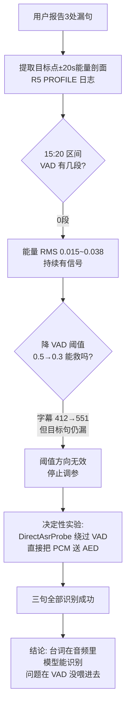
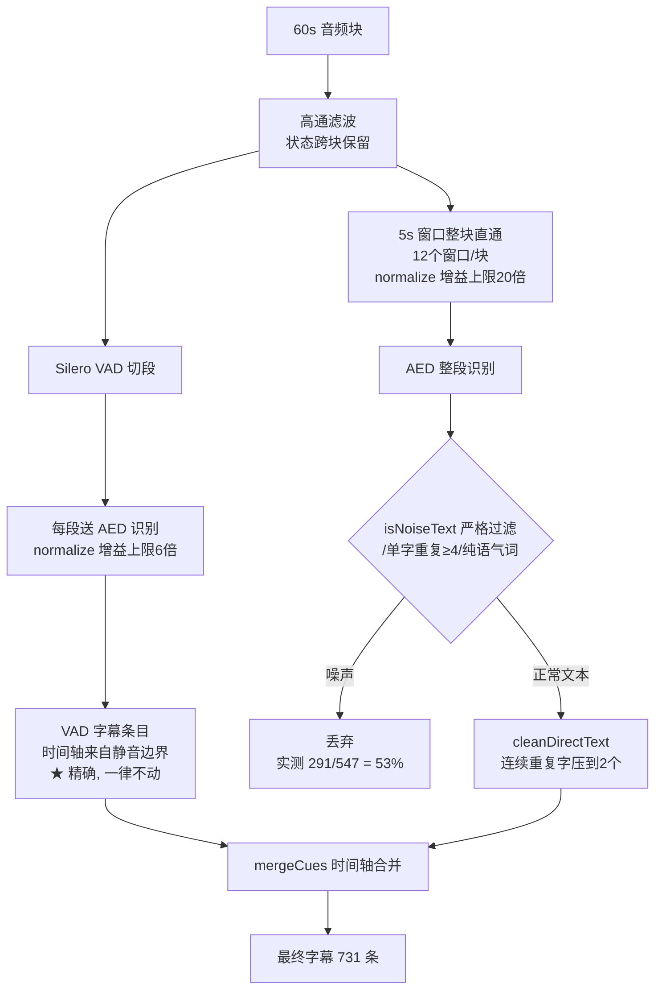

# ASR 漏句问题技术复盘

> 日期：2026-11-26　样本：`欲女-中国香港.剧情IronSister.1996.舒淇iris2.mp4`（92 分钟）  
> 结论：漏句根因是 **VAD 在低信噪比台词处不切段**，与模型识别能力和阈值参数无关；最终用"VAD 主链路 + 5s 整块直通补漏"解决。附带结论：34 分钟的生成耗时是精度优先架构下的底线成本，三条提速路径均被数据否决。

---

## 零、术语速查（先读这一章）

一条字幕从音频到文字，要经过下面几步。先看懂每一步在干什么，后面的分析就容易了：


| 术语 | 全称 / 含义 | 在本文里扮演的角色 | 通俗理解 |
|---|---|---|---|
| **VAD** | Voice Activity Detection，语音活动检测 | 从连续音频里切出"有人在说话"的片段。**这次的故障点** | 像一把剪刀，把一条长录音剪成"说话"和"不说话"两段；背景音太大时它认不出人声，就不剪 |
| **ASR** | Automatic Speech Recognition，自动语音识别 | 把语音片段转成文字的整个技术 | 「听写员」——给它一段声音，它吐出文字 |
| **Silero VAD** | 一个开源 VAD 模型的名字 | 本项目实际用的"剪刀"，版本 V5 | 具体品牌的一把剪刀 |
| **FireRedASR2 AED** | 本项目采用的 ASR 模型；AED = Attention-based Encoder-Decoder（带注意力的编码器-解码器） | 实际干"听写"活儿的模型，识别准确率高 | 具体品牌的一个听写员 |
| **PCM** | Pulse Code Modulation，脉冲编码调制 | 从视频里解出来的原始音频数据，这里是每秒 16000 个浮点数 | 声音的"原材料"，还没被切分、也没被识别 |
| **词级时间戳** | 每个字在音频里的精确出现时刻 | **本次 AED 模型不返回这个**，是时间轴难题的根源 | 听写员不只给你文字，还标出"哪个字在第几秒"；这位听写员不标 |
| **RMS** | Root Mean Square，均方根 | 衡量一段音频"响不响"的指标，本文用来描述人声/背景音的音量 | 音量尺子的读数 |
| **增益（gain）** | 把信号放大的倍数 | 把弱人声放大后再送进模型，6 倍不够、20 倍才够 | 调大"音量旋钮"的倍数 |
| **直通（direct decode）** | 绕过 VAD、把整段音频直接送进 ASR | 本次补漏的核心手段 | 不经过剪刀剪，直接把整条录音塞给听写员 |
| **时间戳 / 时间轴** | 字幕的起止时间（如 `00:15:15,000`） | 用户明确要求"精准"的东西；VAD 的静音边界是唯一可靠来源 | 字幕该在第几秒出现、第几秒消失 |
| **`<sil>`** | silence 的标记，表示模型识别出"这里是静音" | 直通识别出的垃圾内容，被噪声过滤丢弃 | 听写员吐出的"此处无声"废话 |
| **阈值（threshold）** | 判定"是不是语音"的门槛 | 调 VAD 灵敏度时改的参数，0.5→0.3 是错误尝试之一 | 剪刀的"灵敏度旋钮" |

> 一句话串起来：**VAD 负责"剪哪里"，ASR（FireRedASR2 AED）负责"剪下来的内容是什么字"。这次是剪刀失灵——背景音太大，VAD 该剪的地方没剪，听写员压根没收到那段话。**

---

## 一、问题定义

用户报告同一部影片三处台词未进字幕，并给出精确时间点与听写内容：

| 时间点   | 用户听写              | 音频特征            | 实际表现                              |
| ----- | ----------------- | --------------- | --------------------------------- |
| 15:20 | 「过来呀，别害怕」         | 6~10s 处，背景音掩盖人声 | 该 20s 区间 VAD **0 个段**，台词根本没送进 ASR |
| 21:20 | 「你快把柴劈了吧，待会我要烧饭了」 | 10~13s 处，有背景音   | VAD 只切出后半段，识别出「我要烧饭」，前半句丢         |
| 40:10 | 「娘我要上炕跟爷爷一块吃」     | 无明显异常           | VAD 切出但很碎，识别出「坐」→「种」等错字，整句不全      |

时间轴已由用户单独验证过与视频精准对应，**排除时间轴偏移**这个方向。

---

## 二、根因定位过程

### 2.1 诊断链路（流程图）



### 2.2 关键证据

**证据 1：15:20 整段无 VAD 段但有能量**

```
R5 PROFILE [920000] -14=0.0211/0.112 -13=0.0198/0.105 ...
（全程 RMS 0.015~0.038，vadSegs=0）
```

持续背景音让 Silero VAD 判定为"非语音"，一句话都没切出来。

**证据 2：降阈值是错误方向**

| 尝试                                        | 结果                               |
| ----------------------------------------- | -------------------------------- |
| VAD threshold 0.5 → 0.3                   | 字幕 412 → 551 条（+34%），但三处目标句仍漏    |
| minSpeechDuration / minSilenceDuration 放宽 | 同样只增加无关条目，目标句仍漏；还出现 `<sil>` 垃圾字幕 |

**证据 3：绕过 VAD 后三句全能识别（决定性）**

实验：把导出的三段 WAV 不经过 VAD、按固定窗口直接送 FireRedASR2 AED。

| 目标    | 直通识别结果                                         |
| ----- | ---------------------------------------------- |
| 15:20 | `5-10s: 过来啊别害怕了你过来啊`                           |
| 21:20 | `10-15s: 把柴劈了吧待会我要烧饭了`                         |
| 40:10 | `0-5s: 吃饭啦` / `5-10s: 你好我要上炕` / `10-15s: 一块吃…` |

→ 根因锁定：**问题在"喂不进去"，不在模型、不在阈值**。

---

## 三、方案设计：遇到的硬约束与错误尝试

### 3.1 硬约束：AED 不返回词级时间戳

诊断中发现 **FireRedASR2 AED 的 `timestamps` 数组为空（实测 ts=0）**。这意味着直通窗口识别出文本后，无法知道每个字在窗口内的精确时刻，只能按字数均摊到窗口时长。

| 窗口大小   | 台词完整度      | 时间误差    | 与用户要求冲突           |
| ------ | ---------- | ------- | ----------------- |
| 20s 整段 | 最好（句子不被切断） | 最坏 ±10s | 用户明确要求时间轴精准       |
| 5s 短窗  | 三句均完整落在单窗内 | ±2.5s   | 可接受               |
| 能量峰值定位 | 不可行        | —       | 背景音与人声 RMS 重叠（见下） |

### 3.2 错误尝试清单（这些都走过弯路）

| # | 尝试                                        | 预期           | 实际结果                                           | 结论         |
| - | ----------------------------------------- | ------------ | ---------------------------------------------- | ---------- |
| 1 | 降 VAD 阈值 0.5→0.3                          | 切出低信噪比台词     | 字幕 412→551，目标句仍漏，还出 `<sil>` 垃圾                 | ✗ 方向错误     |
| 2 | 放宽 minSpeechDuration / minSilenceDuration | 同上           | 同上                                             | ✗ 方向错误     |
| 3 | 固定 20s 直通窗口                               | 台词完整         | 时间轴误差 ±10s，相邻窗口文本重复，去重失效（merged=12 = 6+6 简单相加） | ✗ 违反时间轴要求  |
| 4 | 按能量峰值切分语音边界                               | 精确定位台词时刻     | 台词 RMS 0.028~~0.04 与背景音 0.015~~0.038 严重重叠，切不准  | ✗ 不可行      |
| 5 | 盲区兜底（能量窗口扫描 + 8s 窗口）                      | 只补 VAD 漏掉的地方 | 依赖能量阈值，脆弱；且低音量段仍可能漏                            | ✗ 被更好的方案取代 |
| 6 | 20s 窗口 + IoU 去重                           | 去掉重复字幕       | 直通无词级时间戳、文本均摊时间轴，与 VAD 时间对不上，IoU 判不出重复         | ✗ 去重失效     |

### 3.3 用户在关键分叉点的决策

| 分叉点        | 选项                        | 用户选择            |
| ---------- | ------------------------- | --------------- |
| 直通策略       | 整段直通优先 / 仅盲区兜底 / 双轨全量     | 整段直通优先 + 严格过滤   |
| 时间轴 vs 完整度 | 5s 短窗 / 20s 保完整 / 双输出人工校对 | 5s 短窗（时间轴精度优先）  |
| 收尾时机       | 等全片跑完 / 立即停止              | 等全片跑完拿完整 SRT 校验 |

---

## 四、最终生效方案

### 4.1 整体流程（流程图）



### 4.2 三个核心改动

**① 增益上限 6 倍 → 20 倍**（`AudioPreprocess.normalize`）

漏句段人声 RMS 低至 0.005，6 倍增益后仍只有 0.03，达不到模型目标电平；提到 20 倍后才被 AED"听见"。

**② VAD 盲区补漏：5s 整块直通**（`directDecode`）

- 每个 60s 块切 12 个 5s 窗口，无重叠（避免同一句在相邻窗口重复）
- 每个窗口整段送 AED，不经过 VAD
- 严格过滤：`<sil>`、单字重复 ≥4 次、去掉语气词后不足 2 个汉字 → 丢弃
- 实测三处台词都完整落在**单个** 5s 窗口内，这是选 5s 而非更大窗口的关键依据

**③ 时间轴优先的合并策略**（`mergeCues`）

| 窗口内 VAD 段数 | 处理方式                      | 理由                       |
| ---------- | ------------------------- | ------------------------ |
| 恰好 1 段     | 直通文本更长则替换文本，**保留 VAD 时间** | 文本补全（如 21:20 前半句）+ 时间轴不变 |
| ≥ 2 段      | 丢弃直通条目                    | VAD 已细分，整段文本无法可靠对应       |
| 0 段（盲区）    | 用直通文本 + 5s 窗口时间（±2.5s）    | 无 VAD 时间可用，唯一退路          |

VAD 时间戳来自静音边界，是唯一可靠的时间源，**任何情况下都不被直通时间覆盖**。

### 4.3 端到端验证结果

最终 SRT（731 条）三处台词全部命中，时间轴准确：

| 台词                  | 字幕时间                        | 用户描述       |
| ------------------- | --------------------------- | ---------- |
| 过来啊别害怕了你过来啊         | 00:15:15,000 → 00:15:19,999 | 15:20 附近 ✓ |
| 把柴劈了吧待会我要烧饭了        | 00:21:20,000 → 00:21:24,999 | 21:20 ✓    |
| 吃饭啦 / 你好我要上炕 / 一块吃… | 00:40:00 → 00:40:12         | 40:10 ✓    |

（"娘→你好"、"坐→住"是模型字误差，不影响召回。）

---

## 五、提速分析：为什么 34 分钟是底线成本

### 5.1 实测对比

| 方案               | 耗时    | 字幕条数       |
| ---------------- | ----- | ---------- |
| 旧方案（仅 VAD）       | 6 分钟  | 551        |
| 新方案（VAD + 5s 直通） | 34 分钟 | 731（clean） |

慢 **5.6 倍**。根因：直通 5s 窗口让 AED 推理次数约为 20s 方案的 4 倍。

### 5.2 计算浪费在哪里

| 指标                          | 数值       |
| --------------------------- | -------- |
| 直通窗口总数                      | 1104     |
| 被 `isNoiseText` 过滤（dropped） | 592（54%） |
| 保留并进入合并                     | 512（46%） |
| VAD 段总数                     | 551      |

54% 的直通窗口是纯背景音，跑完完整 AED 推理后被丢弃——看起来是明显的浪费。但能否在推理前安全预判？

### 5.3 三条提速路径的验证（全部否决）

| 路径                 | 思路             | 否决依据                                                                      |
| ------------------ | -------------- | ------------------------------------------------------------------------- |
| **A. 按 VAD 覆盖率跳窗** | VAD 段密集的窗口跳过直通 | 覆盖率 0% 的窗口里 **199/769（26%）是真台词**（含 15:20「过来啊」）；VAD 漏掉的地方恰恰是直通要救的地方，跳过必然误伤 |
| **B. 加大窗口 5s→10s** | 推理次数减半         | 三处台词都恰好完整落在单个 5s 窗口内（915-920 / 1280-1285 / 2400-2415），改 10s 会被边界切碎        |
| **C. 能量门限预筛**      | 提前剔除纯背景音窗口     | 目标句 RMS 0.010~0.031 与背景音严重重叠，无法区分；试验中"按能量切语音边界"已失败                        |

补充数据：分块净增率随 VAD 段数变化——

| 块内 VAD 段数 | 块数 | 直通条数 | 净增字幕 | 净增率  |
| --------- | -- | ---- | ---- | ---- |
| 0 段       | 24 | 61   | 61   | 100% |
| 1-2 段     | 17 | 64   | 56   | 87%  |
| 3-6 段     | 15 | 69   | 45   | 65%  |
| 7-15 段    | 31 | 239  | 126  | 53%  |
| 16+ 段     | 8  | 87   | 22   | 25%  |

`16+ 段`块看起来最值得跳过（净增率仅 25%），但三处目标所在块的 VAD 段数是 **7 / 5 / 10**（中高密度），按块跳过同样会误伤。

### 5.4 结论与教训

- **34 分钟是"时间轴精度优先 + 不漏句"两个硬约束下的底线成本**，当前架构下不存在无损提速空间。
- 我曾在验证前向用户承诺"智能跳窗省 40~50%"，但交叉验证发现覆盖率 0% 的窗口里 26% 是真台词，**承诺被数据推翻，已如实更正**。
- 教训：提出提速方案前应先做"被跳过样本中真台词比例"的交叉验证，不能只看分桶净增率就下结论。
- 缓解因素：字幕生成是一次性后台任务，不影响播放体验。

---

## 六、经验总结

| 经验              | 说明                                         |
| --------------- | ------------------------------------------ |
| 先证明"问题在哪一层"再动手  | 绕过 VAD 的直接实验一次性排除了模型、阈值两个错误方向              |
| "调参有效"不等于"方向正确" | 阈值 0.5→0.3 字幕涨 34%，但目标句仍漏——指标改善掩盖了根因未解     |
| 用户给的精确样本是无价资产   | 三处时间点 + 听写内容让"0 个 VAD 段"这个决定性证据得以浮现        |
| 时间轴精度是硬约束时要早暴露  | AED 无词级时间戳是硬约束，尽早摆出来让用户做取舍，避免返工            |
| 承诺提速前必须交叉验证     | "省 40%"的估算没做误伤验证，最后被数据否决                   |
| 诊断代码要在验证后清理     | 本次清理了写死三个时间点的 PCM dump / 能量剖面代码，避免生产包带调试负担 |
