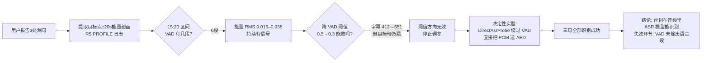
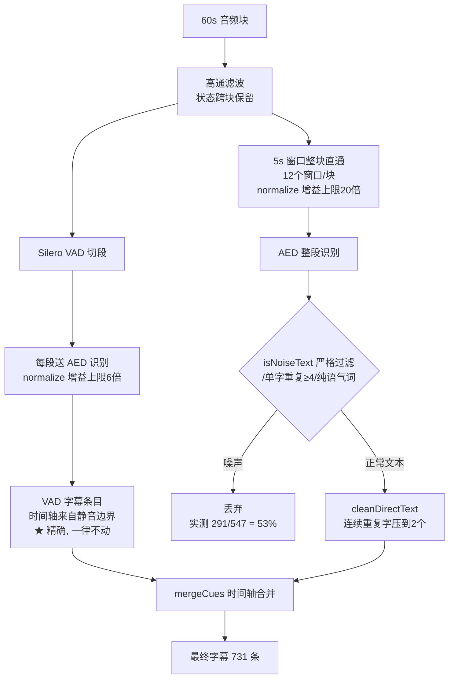

# ASR 漏句问题技术复盘

> 日期：2026-11-26　样本：`欲女-中国香港.剧情IronSister.1996.舒淇iris2.mp4`（92 分钟）  
> 结论：漏句根因是 **VAD 在低信噪比台词处未输出语音段，导致该段音频未被送入 ASR**。绕过 VAD 直接识别可命中台词，证明 ASR 模型本身无误；根因位于 VAD 判决环节，但并非"阈值设错"——实测不存在能分离台词与背景音的阈值，故最终用"VAD 主链路 + 5s 整块直通补漏"解决。附带结论：34 分钟的生成耗时中约 30% 是注定被丢弃的直通推理，可无损跳过（见 5.4）；其余三条提速路径均被数据否决。

---

## 零、术语速查（先读这一章）

一条字幕从音频到文字要经过五步，编号 ①–⑤ 对应下图中每个节点的产出（①PCM、②滤波后 PCM、③语音段、④文字、⑤SRT）。图中标注了每一步的执行者：**含 AI 模型推理的是第 ③④ 步**（VAD 和 AED 各一次），其余都是工程代码：


**图例**：<span style="background:#e8f5e9;color:#1b5e20;padding:2px 8px">绿色 = 工程代码</span>　<span style="background:#fff3e0;color:#e65100;padding:2px 8px">橙色 = AI 模型推理</span>。模型只在 ③④ 两步（VAD 判决、ASR 转写），其余三步全是工程代码；模型节点内部也有工程代码负责送数据、取结果，但核心计算由模型完成。

> 关键澄清：字幕的起止时间由工程代码根据 VAD 切段的静音边界计算，**不是模型输出**。`sherpa-onnx` 只是提供 VAD / ASR 调用接口的工程依赖，模型本身是独立的 `.onnx` 文件。

| 术语 | 全称 / 定义 | 在本文中的作用 |
|---|---|---|
| **VAD** | Voice Activity Detection，语音活动检测。用模型判断每一帧音频是否属于人类语音，输出语音/非语音序列 | 把连续 PCM 切成若干语音段，供 ASR 逐段识别。本次故障发生在这一环节 |
| **Silero VAD** | 本项目使用的 VAD 模型（V5），文件 `silero_vad_v5.onnx`（2.3MB） | 逐帧输出语音概率；工程代码再用阈值、最小时长等参数把概率序列转成语音段。**随 APK 打包在 assets 中**，安装即就位 |
| **ASR** | Automatic Speech Recognition，自动语音识别。把语音音频转为文字的技术 | 本项目的文字识别环节 |
| **FireRedASR2 AED** | 本项目采用的 ASR 模型。AED = Attention-based Encoder-Decoder（基于注意力的编码器-解码器），含 encoder / decoder ONNX（合计约 1.2GB）与词表 | 把语音段识别成汉字。**因体积过大不进 APK，由 App 内下载器装到手机 `files/models/firered_aed/`**——"部署模型"指的就是它；与 VAD 是两个独立模型、分别加载 |
| **PCM** | Pulse Code Modulation，脉冲编码调制。视频音轨经解码后得到的一串按时间排列的音频采样值（每个值代表该瞬间的声波振幅），未经压缩；本项目为 16kHz、单声道、浮点采样 | VAD 与 ASR 的共同输入——尚未切段、也未转成文字的原始音频 |
| **能量** | 一段音频采样值的平方和（或其均方根 RMS），衡量该段信号的强弱。RMS = √(Σx²/n) | 本文用它对比漏句段与静音段、背景音与人声的音量水平 |
| **RMS** | Root Mean Square，均方根，是"能量"的常用度量，量纲与采样振幅一致 | 文中 RMS 数值（如 0.015–0.038）即各时间段的音量读数 |
| **增益（gain）** | 对采样值施加的放大倍数 | 弱人声段需先放大再送模型：上限从 6 倍提到 20 倍 |
| **词级时间戳** | 模型输出的"每个字在音频中的起止时刻"数据 | 本次 AED 的 `timestamps` 数组为空（实测 ts=0），因此无法用它定位台词在窗口内的精确时刻 |
| **`<sil>`** | 模型输出中的静音标记（silence token） | 直通识别结果中的无效内容，被噪声过滤规则丢弃 |
| **阈值（threshold）** | VAD 把"语音概率"判定为语音/非语音的门限，默认 0.5 | 阈值调整（0.5→0.3）是本次的错误尝试之一，详见第二章 |

> 一句话概括：**VAD 决定 ASR 收到哪些音频、以及每段的起止时间；ASR 只负责把收到的音频转成文字。** 本次三处台词对应的音频没有被 VAD 切出，因此未进入 ASR。

---

## 一、问题定义

用户报告同一部影片三处台词未进字幕，并给出精确时间点与听写内容：

| 时间点   | 用户听写              | 音频特征            | 实际表现                              |
| ----- | ----------------- | --------------- | --------------------------------- |
| 15:20 | 「过来呀，别害怕」         | 6–10s 处，背景音掩盖人声 | 该 20s 区间 VAD **0 个段**，台词根本没送进 ASR |
| 21:20 | 「你快把柴劈了吧，待会我要烧饭了」 | 10–13s 处，有背景音   | VAD 只切出后半段，识别出「我要烧饭」，前半句丢         |
| 40:10 | 「娘我要上炕跟爷爷一块吃」     | 无明显异常           | VAD 切出但很碎，识别出「坐」→「种」等错字，整句不全      |

时间轴已由用户单独验证过与视频精准对应，**排除时间轴偏移**这个方向。

---

## 二、根因定位过程

### 2.1 诊断链路（流程图）



### 2.2 关键证据

**证据 1：15:20 整段无 VAD 段但有能量**

```
R5 PROFILE [920000] -14=0.0211/0.112 -13=0.0198/0.105 ...
（全程 RMS 0.015–0.038，vadSegs=0）
```

持续背景音让 Silero VAD 判定为"非语音"，一句话都没切出来。

**证据 2：降阈值是错误方向**

| 尝试                                        | 结果                               |
| ----------------------------------------- | -------------------------------- |
| VAD threshold 0.5 → 0.3                   | 字幕 412 → 551 条（+34%），但三处目标句仍漏    |
| minSpeechDuration / minSilenceDuration 放宽 | 同样只增加无关条目，目标句仍漏；还出现 `<sil>` 垃圾字幕 |

这里需要澄清一个容易产生的疑问：**"VAD 没输出语音段，不就是阈值设得太高吗？为什么又说不是阈值问题？"** 两者的区别在于：

| 判断维度 | "阈值设错"的情形 | 本次的实测情形 |
| ----- | ------------ | ---------- |
| 降阈值后的效果 | 目标句出现，误报可控 | 目标句仍不出现，新增 139 条几乎全是背景音误报 |
| 可分离性 | 台词的语音概率显著高于背景音，存在合适的阈值 | 台词被背景音掩盖，语音概率与背景音重叠，**不存在能分开二者的阈值** |
| 结论 | 调参可修复 | 调参不可修复，属于低信噪比下 VAD 判决能力的固有限制 |

所以"问题在 VAD 判决环节"与"不是阈值问题"并不矛盾：故障确实发生在 VAD 这一层，但它不是某个参数设错了，而是该层在持续背景音条件下无法做出正确判决。

**证据 3：绕过 VAD 后三句全能识别（决定性）**

实验：把导出的三段 WAV 不经过 VAD、按固定窗口直接送 FireRedASR2 AED。

| 目标    | 直通识别结果                                         |
| ----- | ---------------------------------------------- |
| 15:20 | `5-10s: 过来啊别害怕了你过来啊`                           |
| 21:20 | `10-15s: 把柴劈了吧待会我要烧饭了`                         |
| 40:10 | `0-5s: 吃饭啦` / `5-10s: 你好我要上炕` / `10-15s: 一块吃…` |

→ 根因锁定：**台词音频在 PCM 中存在、ASR 模型能正确识别；失效环节是 VAD 未在低信噪比处输出语音段，使该段音频未被送入 ASR。**

---

## 三、方案设计：遇到的硬约束与错误尝试

### 3.1 硬约束：AED 不返回词级时间戳

诊断中发现 **FireRedASR2 AED 的 `timestamps` 数组为空（实测 ts=0）**，即模型只返回识别出的文字，不返回每个字在音频中的时刻。

后果举例：把一段 20s 音频送进 AED，识别出"过来啊别害怕了你过来啊"，而这句话实际在第 6–10 秒。因为模型没给每个字的时间，程序只知道这段文字属于这个 20s 窗口，只能把这段文字**按字数平均摊到整个窗口**上——字幕因此被标成 0–20s，相对真实位置误差最大约 ±10s。这就是"无词级时间戳 → 只能均摊 → 窗口越大误差越大"的因果链。

由此产生窗口大小的权衡（"窗口"指一次送入 AED 的音频时长）。**注意：台词完整度和时间误差是两件事，由两个不同原因决定**——

- **台词是否被切断**：取决于台词是否完整落在一个窗口内。台词若落在单个 5s 窗口内，也必然落在包含它的 10s / 20s 窗口内，所以**加大窗口不会切碎台词**；只有把窗口缩小到小于台词跨度时才会切断。
- **时间误差**：取决于窗口时长。无词级时间戳时只能把文字均摊到整个窗口，窗口越长误差越大。

| 窗口大小 | 台词是否被切断 | 时间误差 | 推理次数（相对 5s） |
| ----- | --------- | ----- | -------------- |
| 20s 整段 | 不会（5s 能装下的，20s 更能装下） | 最坏 ±10s | 1/4 |
| 10s   | 不会 | ±5s  | 1/2 |
| **5s** | 三句均完整落在单窗内 | **±2.5s** | 1（基准） |
| 1–2s  | 会——台词跨度 4–5s，超过窗口长度，被切成两段 | 更小 | 2.5–5 倍 |
| 能量峰值定位 | 不适用 | — | 背景音与人声 RMS 重叠，无法定位（见下） |

为什么台词被切断就识别不全：AED 是编码器–解码器结构，解码当前字时会通过注意力机制参考整段输入的上下文，句子越完整，选字越准。把一句话切成两段后，每段都缺失另一半语境——例如"娘我要上炕跟爷一块吃"若切成"娘我要上"和"炕跟爷一块吃"，前段没有"上炕"这个搭配、后段没有主语，模型只能靠残缺信息猜字，更容易出错；边界处还可能把一个词从中间劈开，两段都识别成无意义音节。这就是"上下文完整"对识别准确率的实际影响。

所以选 5s 的**唯一理由**是时间误差：20s 的 ±10s 违反用户对时间轴精度的要求，而 5s 的 ±2.5s 可接受；同时 5s 又是"三句仍能完整落在单窗内"的最小窗口（实测 915-920 / 1280-1285 / 2400-2415s），再小就会切断台词。**不是因为 20s 会切碎台词——它不会。**

### 3.2 错误尝试清单（这些都走过弯路）

| # | 尝试                                        | 预期           | 实际结果                                           | 结论         |
| - | ----------------------------------------- | ------------ | ---------------------------------------------- | ---------- |
| 1 | 降 VAD 阈值 0.5→0.3                          | 切出低信噪比台词     | 字幕 412→551，目标句仍漏，还出 `<sil>` 垃圾                 | ✗ 方向错误     |
| 2 | 放宽 minSpeechDuration / minSilenceDuration | 同上           | 同上                                             | ✗ 方向错误     |
| 3 | 固定 20s 直通窗口                               | 台词完整         | 时间轴误差 ±10s，相邻窗口文本重复，去重失效（merged=12 = 6+6 简单相加） | ✗ 违反时间轴要求  |
| 4 | 按能量峰值切分语音边界                               | 精确定位台词时刻     | 台词 RMS 0.028––0.04 与背景音 0.015––0.038 严重重叠，切不准  | ✗ 不可行      |
| 5 | 盲区兜底（能量窗口扫描 + 8s 窗口）                      | 只补 VAD 漏掉的地方 | 依赖能量阈值，脆弱；且低音量段仍可能漏                            | ✗ 被更好的方案取代 |
| 6 | 20s 窗口 + IoU 去重                           | 去掉重复字幕       | 直通无词级时间戳、文本均摊时间轴，与 VAD 时间对不上，IoU 判不出重复         | ✗ 去重失效     |

### 3.3 用户在关键分叉点的决策

| 分叉点        | 选项                        | 用户选择            |
| ---------- | ------------------------- | --------------- |
| 直通策略       | 整段直通优先 / 仅盲区兜底 / 双轨全量     | 整段直通优先 + 严格过滤   |
| 时间轴 vs 完整度 | 5s 短窗 / 20s 保完整 / 双输出人工校对 | 5s 短窗（时间轴精度优先）  |
| 收尾时机       | 等全片跑完 / 立即停止              | 等全片跑完拿完整 SRT 校验 |

---

## 四、最终生效方案

方案简称"VAD + 5s 直通"，即**两条流程并行、结果合并**：VAD 主链路（VAD 切段 → AED 识别）提供精确时间轴，5s 整块直通（不经 VAD、按 5s 窗口直接送 AED）补回 VAD 漏掉的台词，最后用 `mergeCues` 按时间合并。

### 4.1 整体流程（流程图）



### 4.2 三个核心改动

**① 增益上限 6 倍 → 20 倍**（`AudioPreprocess.normalize`）

漏句段人声 RMS 低至 0.005，6 倍增益后仍只有 0.03，达不到模型目标电平；提到 20 倍后才达到可识别的输入电平。

**② VAD 盲区补漏：5s 整块直通**（`directDecode`）

- 每个 60s 块切 12 个 5s 窗口，无重叠（避免同一句在相邻窗口重复）
- 每个窗口整段送 AED，不经过 VAD
- 严格过滤：`<sil>`、单字重复 ≥4 次、去掉语气词后不足 2 个汉字 → 丢弃
- 实测三处台词都完整落在**单个** 5s 窗口内，这是选 5s 而非更大窗口的关键依据

**③ 时间轴优先的合并策略**（`mergeCues`）

| 窗口内 VAD 段数 | 处理方式                      | 理由                       |
| ---------- | ------------------------- | ------------------------ |
| 恰好 1 段     | 直通文本更长则替换文本，**保留 VAD 时间** | 文本补全（如 21:20 前半句）+ 时间轴不变 |
| ≥ 2 段      | 丢弃直通条目                    | VAD 已细分，整段文本无法可靠对应       |
| 0 段（盲区）    | 用直通文本 + 5s 窗口时间（±2.5s）    | 无 VAD 时间可用，唯一退路          |

VAD 时间戳来自静音边界，是唯一可靠的时间源，**任何情况下都不被直通时间覆盖**。

### 4.3 端到端验证结果

各阶段字幕条数与三处台词命中情况对比：

| 阶段 | 字幕条数 | 三处台词 |
| --- | ----- | ------ |
| 最初（仅 VAD，阈值 0.5）——用户报告漏句时 | 412 | 全部漏 |
| 错误尝试：降阈值到 0.3 | 551（+34%） | 仍全部漏，新增的多是背景音误报 |
| **最终方案（VAD + 5s 直通，过滤后）** | **731** | **全部命中** |

最终 SRT 中三处台词的具体落点，时间轴准确：

| 台词                  | 字幕时间                        | 用户描述       |
| ------------------- | --------------------------- | ---------- |
| 过来啊别害怕了你过来啊         | 00:15:15,000 → 00:15:19,999 | 15:20 附近 ✓ |
| 把柴劈了吧待会我要烧饭了        | 00:21:20,000 → 00:21:24,999 | 21:20 ✓    |
| 吃饭啦 / 你好我要上炕 / 一块吃… | 00:40:00 → 00:40:12         | 40:10 ✓    |

（"娘→你好"、"坐→住"是模型字误差，不影响召回。）

---

## 五、提速分析：为什么 34 分钟是底线成本

### 5.1 实测对比

| 方案               | 耗时    | 字幕条数       |
| ---------------- | ----- | ---------- |
| 旧方案（仅 VAD）       | 6 分钟  | 551        |
| 新方案（VAD + 5s 直通） | 34 分钟 | 731（clean） |

慢 **5.6 倍**。根因：直通 5s 窗口让 AED 推理次数约为 20s 方案的 4 倍。

### 5.2 计算浪费在哪里

| 指标                          | 数值       |
| --------------------------- | -------- |
| 直通窗口总数                      | 1104     |
| 被 `isNoiseText` 过滤（dropped） | 592（54%） |
| 通过过滤的窗口                     | 512（46%） |
| VAD 段总数                     | 551      |

54% 的直通窗口是纯背景音，跑完完整 AED 推理后被丢弃——看起来是明显的浪费。但能否在推理前安全预判？

（注：下表"直通条目"按字幕条目计数，一个窗口可能切出多条，故合计 520 与上表 512 个窗口不相等。）

### 5.3 四条提速路径的验证

| 路径                 | 思路             | 结论                                                                      |
| ------------------ | -------------- | ------------------------------------------------------------------------- |
| **A. 按 VAD 覆盖率跳窗** | VAD 段密集的窗口跳过直通 | ✗ 覆盖率 0% 的窗口里 **199/769（26%）是真台词**（含 15:20「过来啊」）；VAD 漏掉的地方恰恰是直通要救的地方，跳过必然误伤 |
| **B. 加大窗口 5s→10s** | 推理次数减半         | ✗ 台词不会被切碎（10s 窗口更宽），但均摊时间误差从 ±2.5s 升到 ±5s，违反时间轴精度要求         |
| **C. 能量门限预筛**      | 提前剔除纯背景音窗口     | ✗ 目标句 RMS 0.010–0.031 与背景音严重重叠，无法区分；试验中"按能量切语音边界"已失败                        |
| **D. 跳过 mergeCues 必丢弃的窗口** | 窗口内 ≥2 个 VAD 段时跳过直通推理 | ✓ **无损**：这些窗口的直通文本本来就会被 `mergeCues` 无条件丢弃，跳过推理不改变任何字幕输出。见 5.5 |

补充数据：分块净增率随 VAD 段数变化——

| 块内 VAD 段数 | 块数 | 直通条数 | 净增字幕 | 净增率  |
| --------- | -- | ---- | ---- | ---- |
| 0 段       | 24 | 61   | 61   | 100% |
| 1-2 段     | 17 | 64   | 56   | 87%  |
| 3-6 段     | 15 | 69   | 45   | 65%  |
| 7-15 段    | 31 | 239  | 126  | 53%  |
| 16+ 段     | 8  | 87   | 22   | 25%  |

`16+ 段`块看起来最值得跳过（净增率仅 25%），但三处目标所在块的 VAD 段数是 **7 / 5 / 10**（中高密度），按块跳过同样会误伤。

### 5.4 无损提速：跳过注定被丢弃的推理

前三条路径失败，是因为它们都在赌"某个窗口没有台词"——这个赌注永远有风险。路径 D 不赌：**它跳过的是结果已经被判定丢弃的推理**。

`mergeCues` 有条规则：窗口内 ≥2 个 VAD 段时，直通整段文本无法与各段可靠对应，**无条件丢弃直通**。既然结果必被丢弃，提前跳过 AED 推理对字幕输出零影响。

用一整晚批量生成的日志（2973 个直通窗口）按 `mergeCues` 的精确口径统计：

| 窗口内 VAD 段数 | 窗口数 | 占比 | mergeCues 如何处理 |
| ----------- | ---- | --- | --------------- |
| 0 段         | 1304 | 44% | 唯一补漏源，必须保留 |
| 1 段         | 769  | 26% | 文本更长时替换，保留 |
| **≥2 段**    | **900** | **30%** | **无条件丢弃 → 推理白跑** |

**跳过这 900 次推理，直通计算量减少 30%，字幕逐字不变。** 判定口径与 `mergeCues` 完全相同（同一份 cues、同一个 800ms 重叠阈值），因此不存在"跳过本该保留的窗口"的风险。

### 5.5 结论与教训

- 34 分钟曾是"时间轴精度优先 + 不漏句"下的成本；找到路径 D 后，同架构内可无损减少约 30% 直通推理，字幕不变。
- 我曾在验证前向用户承诺"智能跳窗省 40–50%"，但交叉验证发现覆盖率 0% 的窗口里 26% 是真台词，**承诺被数据推翻，已如实更正**。后来的路径 D 之所以成立，正因为它跳过的不是"疑似没台词"，而是"确定被丢弃"。
- 教训：提出提速方案前应先做"被跳过样本中真台词比例"的交叉验证，不能只看分桶净增率就下结论。
- 缓解因素：字幕生成是一次性后台任务，不影响播放体验。

---

## 六、经验总结

| 经验              | 说明                                         |
| --------------- | ------------------------------------------ |
| 先证明"问题在哪一层"再动手  | 绕过 VAD 的直接实验区分了三种可能：证明 ASR 模型无问题、确认失效在 VAD 环节；随后用降阈值实验排除了"参数设错"这一子原因 |
| "调参有效"不等于"方向正确" | 阈值 0.5→0.3 字幕涨 34%，但目标句仍漏——指标改善掩盖了根因未解     |
| 用户给的精确样本是无价资产   | 三处时间点 + 听写内容让"0 个 VAD 段"这个决定性证据得以浮现        |
| 时间轴精度是硬约束时要早暴露  | AED 无词级时间戳是硬约束，尽早摆出来让用户做取舍，避免返工            |
| 承诺提速前必须交叉验证     | "省 40%"的估算没做误伤验证，最后被数据否决                   |
| 诊断代码要在验证后清理     | 本次清理了写死三个时间点的 PCM dump / 能量剖面代码，避免生产包带调试负担 |

---

## 七、后续演进方向：带词级时间戳的模型

本次选 5s 窗口、承担 34 分钟耗时，根源是 AED 不返回词级时间戳。一个自然的追问是：**若换成精度相当、但输出词级时间戳的 ASR 模型，是否就能放大窗口、同时兼顾时间精度与识别准确度？** 结论是原理上成立，但有三个前提必须实测。

### 7.1 时间戳到位后，VAD 不再是唯一时间源

| | 当前方案（AED 无时间戳） | 换用带时间戳模型后 |
|---|---|---|
| 字幕时间来源 | 只能取 VAD 静音边界；VAD 漏句处退化为窗口均摊 | 模型直接给出每字起止时刻，与 VAD 无关 |
| 窗口大小约束 | 被时间误差锁死在 5s（±2.5s） | 不再受时间误差约束，可放大 |
| VAD 角色 | 时间源 + 语音切分，缺一不可 | 退化为可选的语音/噪声预筛 |
| 漏句根因是否还在 | VAD 不切段 ⇒ 台词不进 ASR | 若做全量直通，VAD 环节可被绕过，根因消失 |

### 7.2 大窗口的收益与代价

| 维度 | 影响 | 说明 |
|---|---|---|
| 时间精度 | **改善** | 每字时刻由模型给出，不再随窗口增大而劣化；这是放大窗口的前提 |
| 识别准确度 | 可能改善，但非单调 | 上下文更完整有利于选字（见 3.1 的切断分析）；但过长输入可能触发注意力稀释或模型长度上限，需实测找最优点 |
| 推理次数 | 下降 | 20s 窗口是 5s 的 1/4 次，60s 是 1/12；耗时有望从 34 分钟大幅回落 |
| 幻觉/重复风险 | 上升 | 本诊断中 20s 窗口已出现相邻窗口文本重复；窗口越大，单个窗口内混入无关语音的概率越高 |

### 7.3 三个必须先验证的前提

1. **精度是否真能匹敌**：候选模型（如 Whisper、SenseVoice、带对齐头的 Paraformer 系）中文影视剧场景的准确率要与 FireRedASR2 AED 实测对比——换了模型却漏更多字，则得不偿失。注意 Paraformer 系在本项目需求 R3 中已被明确移除，重新引入与既定范围冲突，需用户重新决策。
2. **时间戳质量**：模型输出的词级时间戳本身精度如何？Whisper 类模型的时间戳由注意力对齐推导，在本次的低信噪比场景下同样可能漂移，需要用三处已知台词（6–10s / 10–13s / 6–10s）校准验证。
3. **窗口最优点**：大窗口不必然更准。需以 5s / 10s / 20s / 60s 做对照实验，用「错字数 + 漏句数 + 耗时」三维指标选点，而非直接取最大。

### 7.4 另一条路径：不换模型，补对齐

保留 FireRedASR2 AED 的识别能力，另接一个**强制对齐（forced alignment）模型**：AED 先出文字，对齐模型再依据音频给这段文字标注每字时刻。这样时间戳与 VAD 解耦，窗口同样能放大。

已核实当前集成的 sherpa-onnx v2.0.1 **不含** `OfflineForcedAligner`（124 个类中无此类，native 库无对齐符号）。若走这条路，需升级 sherpa-onnx 版本并引入对齐模型（额外体积与下载）。

这条路不改变识别模型，因此**不产生 7.3 第 1 点的精度风险**。是否值得取决于另外两项实测：

| 判断依据 | 验证方法 |
|---|---|
| 对齐精度是否达标 | 用三处已知台词（6–10s / 10–13s / 6–10s）校准对齐模型输出的每字时刻，确认其误差小于当前 5s 均摊的 ±2.5s |
| 收益是否覆盖引入成本 | 实测窗口放大后的耗时下降幅度，与新增模型体积、sherpa-onnx 升级成本对比 |

**当前决定**：7.4 方案保留，次日（2026-11-27）进行验证；本轮不改动生产代码。
