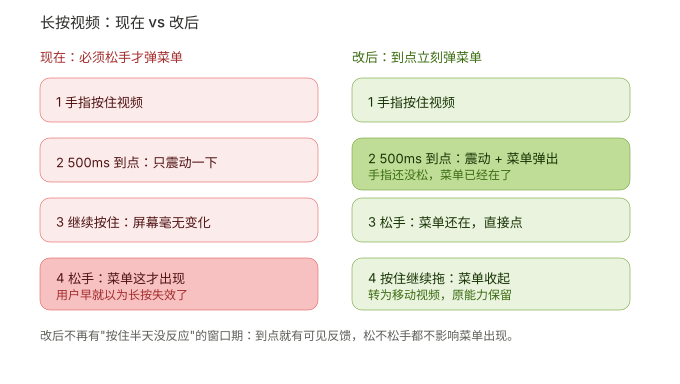
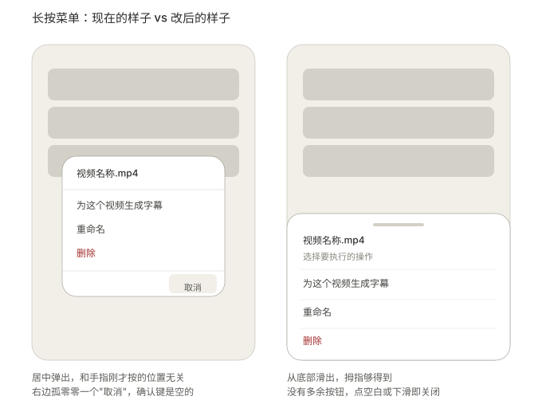
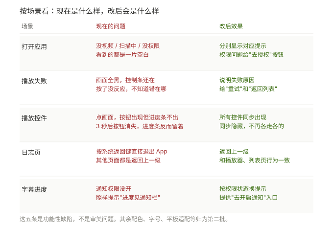

# 体验改进清单（业务视角）

日期：2026-11-28
状态更新：2026-11-28 17:55，对应已装机版本 `lastUpdateTime=17:54:08`

这份文档不讲代码位置，只讲三件事：**现在是什么样、问题在哪、改完是什么样**。
需要查具体改哪一行，看同目录的 `UI交互审阅-20261128.md`（技术版）。

**状态说明：**

| 标记 | 含义 |
|---|---|
| 已改 | 已改完、编译通过并装到手机上 |
| 部分改 | 只解决了最影响体验的部分，另一部分按下面的说明搁置 |
| 不改 | 你明确说不改 |
| 不做 | 技术上不成立或风险大于收益，理由见第四节 |

**统计：28 条 → 已改 24、部分改 1、不改 2、不做 1。**

---

## 一、已装机的两条

### 1. 长按视频没反应

**改之前**：按住视频 500ms 会震动一下，但屏幕上什么都不发生。必须松手，菜单才弹出来。用户按了半秒看不见任何东西，自然认为"长按坏了"，于是再按一次、或者干脆放弃。

**问题本质**：反馈给得太晚。震动是唯一信号，而震动很容易被忽略或在静音模式下感知不到。

**改之后**：按住到 500ms，震动的同时菜单立刻弹出，手指还按着就能看到。松手菜单还在，直接点。如果按住后想移动视频，继续拖就行，菜单会自动收起、进入移动模式——原来的拖动能力没丢。

---

### 2. 菜单样式难看

**改之前**：菜单是屏幕正中间弹出来的一块对话框，和用户刚才按的那个视频位置完全无关。对话框底部只有一个孤零零的"取消"按钮，确认位置是空的，看着像没做完。

**改之后**：菜单从屏幕底部滑出，标题显示视频/文件夹名，下面一行一个操作，删除用红色。没有多余按钮，点空白处或下滑就关掉。单手拿着手机也能轻松够到。

---

## 二、问题清单与状态（按使用场景）

级别说明：**必修** = 功能缺陷，用户会撞上；**建议** = 体验优化，不影响主流程。

### A. 打开应用的第一屏

| 现在是什么样 | 问题 | 改完是什么样 | 级别 | 状态 |
|---|---|---|---|---|
| 手机里没视频、正在扫描、没给文件权限，这三种情况看到的都是**同一片空白** | 用户分不清是"没视频"还是"卡住了"还是"没给权限"，也没有任何去授权的入口 | 三种情况分别提示；没权限时直接给一个"去设置授权"按钮 | 必修 | 已改 |
| 打开瞬间先空白，然后突然出现一堆视频 | 不知道后台在干活，大目录扫描慢时像卡死 | 扫描期间显示"正在读取视频…"和数量进度 | 必修 | 已改 |
| 列表项点不动（读屏软件用户） | 旁白/TalkBack 用户无法打开任何视频，整页不可用 | 每一项都能被读屏识别为可点击，并念出文件名 | 必修 | 已改 |

### B. 浏览列表

| 现在是什么样 | 问题 | 改完是什么样 | 级别 | 状态 |
|---|---|---|---|---|
| 想按文件名找视频，找不到入口 | 搜索功能其实写好了，但没有输入框，等于没有 | 顶栏加搜索图标，输入即过滤 | 必修 | 不改（你决定不要搜索） |
| 长按稍微手抖一下，可能什么都不发生 | 按住时手指漂移超过一点点，既不算点击也不弹菜单，进入空档 | 已随长按改造一并解决（拖动阈值放宽到 2 倍） | 已修 | 已改 |
| 删除文件夹、批量删除后不能撤销 | 一旦点错，文件直接没了 | 删除后在底部给 5 秒"撤销"提示 | 建议 | 不做（理由见第四节） |
| 列表最后一项会被手机底部的手势条挡住一点 | 全面屏手机上最后一行显示不全 | 底部留出手势条的安全距离 | 建议 | 已改 |
| 平板上是单列超宽卡片，文字被拉得很长 | 大屏体验差，一屏看不了几条 | 平板自动切成两列或多列 | 建议 | 部分改（只做了两侧留白，多列搁置） |

### C. 播放视频

| 现在是什么样 | 问题 | 改完是什么样 | 级别 | 状态 |
|---|---|---|---|---|
| 视频文件损坏或格式不支持时，**画面全黑**，控制条还在但按了没反应 | 用户完全不知道发生了什么，只能退出去猜 | 黑屏上直接说明"这个视频无法播放"，给"重试"和"返回列表" | 必修 | 已改 |
| 进入播放页先黑一下，然后才出画面 | 大文件或慢存储上像卡死 | 显示加载圈，缓冲时也显示 | 必修 | 已改 |
| 点一下画面，出现按钮但进度条不出现；过 3 秒按钮消失，进度条反而留在屏幕上 | 控件各走各的，出现和消失都不同步，看着很乱 | 整组控件一起出现、一起消失 | 必修 | 已改 |
| 点画面正中间想暂停，要等 0.3 秒才响应 | 最常用的操作有明显迟滞 | 中间区域立刻响应，只有边角区域才需要等双击判定 | 必修 | 已改 |
| 每次进播放页，字幕都自动打开 | 用户上次关掉字幕的选择不被记住，每次都要再关一次 | 记住上次的选择 | 必修 | 已改 |
| 横滑拖进度条时画面卡顿，也看不到拖到哪儿了；时间提示块挡在画面正中间 | 高刷屏上拖动会一顿一顿，提示遮住视频主体 | 拖动时只预览、松手才跳转；时间提示移到**画面右侧**，不挡内容 | 必修 | 已改 |
| 音量显示成"12/15"这种数字 | 看不懂，而且和亮度的百分比表达不一致 | 统一显示成百分比 | 建议 | 已改 |
| 旋转按钮只能在"横屏"和"竖屏"之间硬切 | 平板或折叠屏上，转动机身不会自动适配 | 增加"自动旋转"选项 | 建议 | 不改（你决定不加减） |
| 字幕最多两行，第三行直接被切掉，字号也不能调 | 长句被截断，小屏看不清 | 超出显示省略号，并提供字号设置 | 建议 | 已改 |

### D. 字幕生成

| 现在是什么样 | 问题 | 改完是什么样 | 级别 | 状态 |
|---|---|---|---|---|
| 通知权限没开，点生成照样提示"进度见通知栏" | 用户去通知栏什么也看不到，以为没在生成 | 按权限状态换提示，并提供"去开启通知" | 必修 | 已改 |
| 提示"去设置并开始"后，还没等用户授权就先把任务启动了 | 文案承诺"锁屏后继续"，实际启动时并没有这个权限，承诺兑现不了 | 从设置返回后先检查授权结果，再决定是否启动 | 必修 | 已改 |
| 模型下载只显示一个百分比数字 | 1.2GB 的下载，不知道下到哪了、是不是卡住了；也没提醒当前是流量还是 WiFi | 加进度条、已下载大小，移动网络下先确认 | 必修 | 已改 |
| 取消下载后直接回到"开始下载"，没有说明 | 用户不知道已下的部分还在不在、下次要不要重来 | 明确提示"已取消，下次从头开始" | 建议 | 已改 |
| "全量生成"这个名字和它的说明对不上 | 名字像"全部重做"，说明写的却是"只补没有字幕的" | 改名为"补齐缺失字幕" | 建议 | 已改 |
| **新增**：任务被打断后，通知栏里什么都没有 | 安装新版本、系统杀进程时，服务来不及发通知，连"为什么停了"都看不到；「继续生成」按钮也无处可寻，用户只能一脸茫然 | 列表页顶部常驻一条：运行中显示"正在生成字幕 + 进度条"，被打断时变成"上次生成被打断了"+「继续生成」，点一下从下一条接着跑 | 必修 | 已改 |

### E. 日志页与设置

| 现在是什么样 | 问题 | 改完是什么样 | 级别 | 状态 |
|---|---|---|---|---|
| 在日志页按系统返回键，**直接退出整个 App** | 其他页面都是返回上一级，只有这里退出，极易误操作 | 返回上一级 | 必修 | 已改 |
| 日志顶部有刷新和导出按钮，下面又有一排"导出并分享/刷新" | 同一个功能出现两次，小屏上还挤 | 只保留一组 | 建议 | 已改 |
| 自检卡片显示"心跳 / 唤醒锁 / 前台服务" | 普通用户看不懂这些词 | 翻成一句结论，例如"锁屏后可以继续生成" | 建议 | 已改 |
| 没有设置页 | 主题、字幕字号、默认倍速、存储占用都没地方调 | 做一个最小设置页 | 建议 | 已改 |
| 深色模式下部分色块和滚动条还是浅色的 | 深色模式只做了一半，看起来脏 | 所有颜色跟随主题 | 建议 | 已改 |

---

## 三、还剩什么

第一轮（上面这批）已全部完成并装机。剩下的都是明确搁置项：

1. **删除后 5 秒撤销**——不做，理由见第四节。
2. **平板多列**——搁置，理由见第四节。
3. **搜索入口、旋转模式**——你说不改。
4. **存储占用**：1.24G 里 1.179G 是离线字幕模型本身（encoder 817MB + decoder 417MB），删了就不能离线生成字幕；字幕文件不在其中，它写在视频同目录。可清的零头只有 6MB 左右（旧备份 2MB、调试残留 4MB），收益很小。

---

## 四、本轮落地情况（2026-11-28 下午）

**按你的要求不改：** 搜索入口、旋转按钮（保持横竖两态）。

**已改完：**

| 场景 | 改成了什么 |
|---|---|
| 播放页横滑 | 时间提示从画面正中移到**右侧**，带进度条，不再挡画面；拖动中只预览，松手才跳转，不再一顿一顿 |
| 第一屏 | 没权限 / 正在读 / 没视频三种情况分别提示；没权限直接给"去授权 + 系统设置"两个按钮；扫描时显示"已找到 x / y 个" |
| 列表 | 每行都能被读屏软件念出名字并双击打开；最后一行不再被手势条压住；平板两侧自动留白，一行字不再横跨整屏 |
| 播放失败 | 黑屏中间说明"这个视频无法播放"并给「重试」「返回列表」；进入和缓冲时都有转圈 |
| 播放控件 | 返回、字幕、倍率、旋转和进度条**同进同出**；点正中间暂停**立即生效**，不再等 0.3 秒 |
| 字幕 | 记住上次开关；两行后给省略号；字号小/中/大可在设置里调，带实时预览 |
| 音量 | 显示成百分比，和亮度一致 |
| 字幕生成 | 没开通知权限时明确提示并给"去开启"；"去设置并开始"改成**回来确认授权后再启动**；"全量生成"改名为"补齐缺失字幕" |
| 任务提示条 | 列表页顶部常驻：运行中显示进度，被打断时给「继续生成」，不用去通知栏翻按钮 |
| 模型下载 | 加进度条和"已下载 x / y MB"；移动网络下先确认；取消后明确提示"下次从头开始" |
| 日志页 | 返回键回上一级，不再直接退出 App；去掉重复的按钮；自检改成一句话结论（如"正在生成，锁屏后可以继续"），技术细节收进"查看详情" |
| 设置页 | 新增：主题（跟随系统/浅色/深色）、字幕字号、版本信息 |
| 深色模式 | 文件夹/视频图标底色、右侧滚动条跟随主题，不再有亮块 |

**没做的两条：**

- **删除后 5 秒撤销**：现在是真的物理删除文件，删掉后系统里没有副本，无法恢复。要做撤销只能改成"先移到回收站、5 秒后再真删"，涉及移动大文件的耗时和失败回滚，风险比收益大，暂时保留二次确认。
- **平板多列**：换网格会打乱"上次看到第几行"的恢复逻辑（现在按列表下标记位置），这轮先用两侧留白把阅读宽度收住，多列等单独排期。
